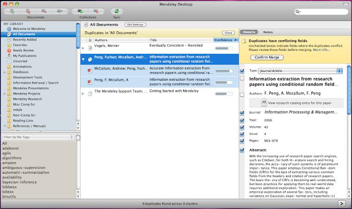
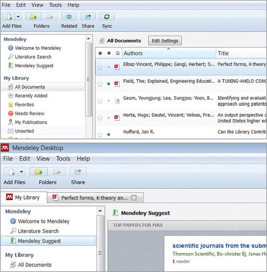

# Mendeley Reference Management for Research and Writing

Mendeley helps researchers collect literature, organize references, read PDFs, and prepare citations.
Its tools connect library management with browser-based collection and writing in Microsoft Word.

[](https://github.com/mendeley-citation-manager/mendeley-desktop/releases/)

## A Connected Research Workflow

Mendeley Reference Manager holds the references and documents used throughout a research project.
A useful library combines accurate metadata with a clear system for finding material again.

### From Discovery to a Draft

1. Save a promising reference or import a document.
2. Check its bibliographic details.
3. Place it in a relevant collection.
4. Read and annotate the available PDF.
5. Insert the appropriate citation while writing.
6. Review the resulting bibliography before submission.



## Which Mendeley Component Do You Need?

| Component | Main responsibility | Typical use |
| --- | --- | --- |
| Reference Manager | Manage references, documents, and reading notes | Maintain the research library |
| Mendeley Web Importer | Capture supported references from browser pages | Collect literature during discovery |
| Mendeley Cite | Insert citations and bibliographies in Word | Cite sources while drafting |
| Mendeley Desktop | Legacy reference management application | Continue an existing older workflow |

Mendeley Web provides browser access to the current reference management workflow.
The desktop Reference Manager and the browser experience should not be confused with the legacy Desktop application.

### Working With an Existing Library

Mendeley Desktop remains available for users who need the older application.
It no longer receives software updates, and compatibility with future operating systems is not guaranteed.

Keep a copy of important manuscripts before changing how their citations are managed.
Check a representative document before committing a long project to a different workflow.

## Collect References and Papers

References can come from imported PDFs, manually entered records, or supported bibliographic exchange formats.
Web Importer provides another route when you are working in a browser.

### Metadata Review

- Confirm author names and their order.
- Check the title and publication year.
- Select the correct reference type.
- Verify the journal or book title.
- Check volume, issue, and page details where relevant.
- Inspect identifiers such as DOI or ISBN.

Automatic extraction is a convenience rather than a final authority.
Compare uncertain details with the publication itself or the publisher's record.

### Browser Collection

Use Web Importer on supported pages to capture the references you need.
Check what was saved, including whether a PDF was actually attached.

## Bibliographic Exchange Formats

Mendeley supports standard formats for moving references between tools.
BibTeX, RIS, and EndNote XML are useful when a direct transfer is unavailable.

The following BibTeX entry describes a published book:

```bibtex
@book{knuth1984texbook,
  author = {Donald E. Knuth},
  title = {The TeXbook},
  publisher = {Addison-Wesley},
  year = {1984}
}
```

Save an entry like this as a BibTeX file and use the corresponding library import option.
Inspect the imported record before adding a large batch.

### Equivalent RIS Record

The same book can be represented using tagged RIS data:

```text
TY  - BOOK
AU  - Knuth, Donald E.
TI  - The TeXbook
PB  - Addison-Wesley
PY  - 1984
ER  -
```

Use one representation when testing an import to avoid creating the same reference twice.
These examples are bibliographic records, not Mendeley application settings.

Different exchange formats preserve different fields.
Check author names, reference types, and identifiers after moving a library.

## Reading, Highlights, and Notes

The PDF reader supports highlighting and annotations for close reading.
Use notes to capture the argument, method, limitations, and relevance of a paper.

### Notes That Support Writing

Record the page associated with a useful quotation or result.
Distinguish an author's statement from your own interpretation.

Mendeley Notebook helps bring research notes together.
Keep enough context that a note still makes sense after time away from the project.



## Citations and Bibliographies in Word

Mendeley Cite connects the reference library to Microsoft Word.
It can insert citations and build a bibliography using a selected citation style.

### A Reliable Citation Routine

1. Place the cursor where the citation belongs.
2. Find the intended reference in Mendeley Cite.
3. Insert the citation through the add-in.
4. Add any required locator, such as a page number, through supported citation controls.
5. Insert or update the bibliography.
6. Review the result against the required style.

The Mendeley citation manager workflow depends on the accuracy of the underlying records.
Changing a style cannot supply a missing author, page range, or publication date.

### Style and Manuscript Checks

Choose the exact style required by the journal, department, or publisher.
Check punctuation, capitalization, author presentation, and the treatment of repeated citations.

Keep document editing and citation editing coordinated.
Use the add-in's controls when modifying managed citations so the bibliography can remain consistent.

## Synchronization and Shared Work

Synchronization makes the library available across the connected Mendeley environments.
Confirm that recent changes have synchronized before moving to another computer.

Use the same account when checking whether an expected reference is available.
A missing item may reflect account selection or synchronization rather than a failed import.

### Groups and Collaboration

Groups support sharing references with other researchers.
Agree on collection names and basic metadata conventions before several people add material.

Check group access and available storage when planning a shared project.
Document which resources collaborators need for the intended workflow.

## Exports and Independent Copies

Exporting references provides a portable copy of bibliographic metadata.
An export should not be assumed to contain every attached document and annotation.

The standard reference export contains metadata; PDF attachments are referenced rather than directly included.
Preserve important PDFs separately and use the appropriate annotated-PDF export when needed.

### Before a Major Change

- Export the references you need in a supported format.
- Retain the source PDFs required for the project.
- Check how annotations will be preserved.
- Keep copies of important Word manuscripts.
- Test the exported records in the destination application.

## Versions, Updates, and Help

The current stable Reference Manager release checked for this guide is v2.151.0.
Mendeley Cite and Web Importer have their own release histories.

For a support request, identify the component, version, operating system, and action that failed.
For a Word issue, also record the Word environment and whether the document uses Mendeley Cite.

Try a small test document or a single reference to narrow down the problem.
Describe the expected result and the observed behavior without including unrelated research material.

## Ownership and Licensing

Mendeley originated with Paul Foeckler, Victor Henning, and Jan Reichelt.
It is now part of Elsevier.

The application and its services are provided under their applicable proprietary terms.
Check account, storage, institutional access, and optional feature conditions for your own research workflow.

## Related Search Terms

mendeley reference manager, mendeley cite, mendeley desktop, mendeley web, mendeley citation manager, reference-manager, bibliography, citation, bibtex, biblatex, research, research-tool, references, paper-management, publications
